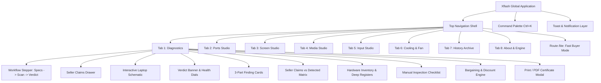

# Product Design Specification & UI/UX Brief: Xflash Hardware Diagnostics

**Document Version:** 4.1.0  
**Project ID:** `xflash` (Xflash Diagnostics)  
**Brand Meaning:** *"Exploring the Unknown (`X`) through Swift Sub-Second Flashes (`Flash`)"* — An offline-first, portable hardware testing kit that pierces the veil of used laptop uncertainty.  
**Target Audience for Document:** Design Director, Lead Product Designer, Brand Strategist  
**Classification:** Confidential & Proprietary Product Specification  

---

## 1. Executive Summary & Project Vision

### 1.1 The Core Problem
Buying a used, refurbished, or marketplace laptop (ThinkPad, MacBook, Dell XPS, HP EliteBook, gaming laptops) is fraught with asymmetric information and financial risk. Sellers routinely quote original marketing specs while concealing heavily degraded battery packs, worn NVMe SSDs with media integrity errors, unadvertised single-channel RAM downgrades, choked thermal dissipation, or intermittent keyboard and trackpad switches. 

Existing diagnostic tools fail buyers in critical ways:
1. **Cloud Lock-in & Privacy Leaks:** Requiring internet access or uploading laptop serial numbers to remote servers when testing a machine you do not yet own.
2. **Deceptive Single Scores:** Oversimplified "95% Health" badges that conceal failing storage sectors or counterfeit batteries.
3. **Walls of Numbers:** Tools like HWiNFO or AIDA64 overwhelm buyers with dense technical telemetry, offering zero actionable guidance while standing across from a seller.
4. **Destructive Testing Risks:** Invasive disk-write benchmarks or extreme stress tests that can crash or destabilize a seller's machine during an inspection.

### 1.2 The Product Solution: Xflash
**Xflash** is the **honest second opinion for used laptop buyers**. Running **100% offline** directly from a **zero-trace bootable USB drive** with zero external dependencies and zero host installation, Xflash executes safe, non-destructive, read-only diagnostic scans in under 3 minutes. 

It translates raw sensor data into:
- **Plain-English Verdicts:** Clear assessment of hardware condition and risk.
- **3-Part Negotiation Leverage Cards:** What is wrong, why it matters, and exact bargaining advice.
- **Interactive Testing Studios:** Dedicated test suites for display panels, audio, keyboard switch chatter, trackpad zones, and thermal rise velocity.
- **A Tamper-Evident Print/PDF Buyer Certificate:** A single-page physical negotiation asset stamped with a local SHA-256 session integrity seal.

---

## 2. Target Personas & Context of Use

| Persona | Archetype | Environment & Context | Key UI Needs |
| :--- | :--- | :--- | :--- |
| **"Alex" — The Marketplace Buyer** | Casual to semi-technical consumer buying via Craigslist, Facebook Marketplace, or local classifieds. | Dimly lit coffee shop or parking lot meetup; 5–10 minutes maximum; high anxiety; seller watching over shoulder. | High-contrast glanceability, green/amber/red indicators, plain-English explanations, clear dollar negotiation advice, zero technical jargon required. |
| **"Sam" — The Hardware Enthusiast** | Tech-savvy buyer, student, or power user inspecting high-end ThinkPads, MacBooks, or workstation laptops. | Shop counter or quiet desk; wants to verify RAM channels, EDID panel types, and NVMe controller endurance. | Toggleable **Expert Mode**, deep-links from plain findings to raw register dumps, CPU core topology, millisecond switch bounce logs. |
| **"Elena" — The Refurbisher / Bench Tech** | Professional technician or reseller testing 20–50 laptops daily. | Repair workbench; rapid keyboard-driven workflow; batch testing. | `Ctrl+K` Command Palette, hotkey navigation, instant USB report persistence, clean-wipe discrepancy checks, printable certificates to tape onto hardware. |

---

## 3. Brand Identity & Design Philosophy

### 3.1 Brand Personality & Tone
- **Precision Instrument, Not Generic SaaS:** The UI must feel like a precision diagnostic instrument (inspired by Teenage Engineering, Braun/Dieter Rams, and Apple Hardware DevTools) rather than a cookie-cutter SaaS dashboard.
- **Radical Honesty & Transparent Uncertainty:** If a sensor is unavailable, unreadable, or missing, the UI **never** silently defaults to zero or "Pass". It proudly labels it `Inconclusive`, `Unsupported`, or `Requires Manual Inspection`.
- **Zero-Slop Aesthetic:** No decorative gradients, no generic AI-generated artwork, no fake marketing fluff. Every pixel, line, border, and badge communicates real hardware state.

### 3.2 Logo & Brand Marks
- **Wordmark:** `Xflash` with bold monospace `X` and high-contrast clean sans `flash`.
- **Primary Mark:** An open circular circuit track that closes with an electric emerald spark at 12 o'clock, symbolizing rapid electrical continuity and diagnostic precision.
- **Tagline:** *"Check before you pay."*

### 3.3 Anthropic-Aligned Color Theme Triad (100% Offline)
Xflash features a refined design palette aligned with Anthropic's brand guidelines, balancing technical precision with warm editorial readability:

1. **Anthropic Light (Porcelain Clean / Default):**
   - *Atmosphere:* Crisp, natural, uncluttered daylight inspection aesthetic.
   - *Background:* `#faf9f5` (Light Porcelain) / `#ffffff` (Elevated Cards)
   - *Text:* `#141413` (Dark Charcoal Primary), `#b0aea5` (Mid Gray Subdued)
   - *Borders:* `#e8e6dc` (Light Gray Structural)
   - *Accents:* `#d97757` (Anthropic Terracotta Orange), `#6a9bcc` (Soft Blue Secondary)

2. **Anthropic Dark (Carbon Precision / Dim Environments):**
   - *Atmosphere:* Deep charcoal black, subtle contrast, zero eye fatigue in dim coffee shops or nighttime parking lots.
   - *Background:* `#141413` (Deep Dark) / `#1f1f1d` (Elevated Surfaces)
   - *Text:* `#faf9f5` (Light Off-White Primary), `#b0aea5` (Subtle Secondary)
   - *Borders:* `#353532` (Muted Charcoal Border)
   - *Accents:* `#d97757` (Warm Terracotta Accent), `#788c5d` (Earthy Olive Green)

3. **Warm Humanist (Ivory Paper / Archival Report):**
   - *Atmosphere:* Warm parchment/editorial aesthetic for printed PDF certificates and inspection review.
   - *Background:* `#f6f3eb` (Warm Ivory Paper) / `#ffffff`
   - *Text:* `#1e1e1c` (Deep Ink), `#8c887b` (Warm Subtitle)
   - *Borders:* `#ded9cd`

### 3.4 Semantic Status Palette (Deterministic & Accessible)
- **Healthy / Pass:** Anthropic Olive Green (`#788c5d` light / `#8aa26d` dark)
- **Warning / Review:** Terracotta Amber (`#d97757` / `#e58564`)
- **High Risk / Critical:** Ruby Crimson (`#d44333` / `#e05545`)
- **Inconclusive / Neutral:** Slate Blue (`#6a9bcc` / `#7eaedc`)
- **Muted / Untested:** Subdued Gray (`#b0aea5` / `#787771`)

---

## 4. Design System Tokens & Typography Scale

### 4.1 Typography (Anthropic Design Language)
- **Headings & Hierarchy:** Geometric Sans (`Poppins, Arial, "Segoe UI", sans-serif`) with weights `600` and `700` for clear, readable headlines and card titles.
- **Body & Explanations:** Editorial Serif (`Lora, Georgia, serif`) for high-legibility narrative explanations, negotiation scripts, and buyer advice.
- **Data & Telemetry Monospace:** Tabular Monospace (`"JetBrains Mono", "SF Mono", "Cascadia Code", monospace`) with `font-feature-settings: "tnum" 1` enabled globally for non-shifting tabular numerals, hex addresses, and SMART registers.

| Token | Family | Size | Weight | Line Height | Usage |
| :--- | :--- | :--- | :--- | :--- | :--- |
| `font-display` | Poppins / Arial | 32px / 2.0rem | 700 Bold | 1.15 | Main Hero Verdict, Certificate Title |
| `font-title-lg` | Poppins / Arial | 24px / 1.5rem | 600 SemiBold | 1.25 | Tab Titles, Studio Headers |
| `font-title-md` | Poppins / Arial | 18px / 1.125rem | 600 SemiBold | 1.35 | Card Section Headers, Dial Values |
| `font-body-md` | Lora / Georgia | 14px / 0.875rem | 400 Regular | 1.55 | Finding Explanations, Negotiation Scripts |
| `font-body-sm` | Poppins / Arial | 12px / 0.75rem | 500 Medium | 1.40 | Meta details, Sublabels, Timestamps |
| `font-mono-data`| JetBrains / Mono | 13px / 0.8125rem| 500 Medium | 1.40 | Register Values, Capacities, Hex Codes |
| `font-badge` | Poppins / Arial | 11px / 0.6875rem| 700 Bold | 1.00 | Pill tags, Severity indicators, Hotkeys |

### 4.2 Elevation, Radii & Grid
- **Base Grid:** 8px base grid system with 4px micro-steps.
- **Border Radii:**
  - Micro (`rounded-xs`): 4px (Kbd shortcuts, tiny tags)
  - Small (`rounded-sm`): 6px (Input fields, buttons, badges)
  - Medium (`rounded-md`): 10px (Subsystem cards, schematic zones)
  - Large (`rounded-lg`): 14px (Verdict hero banner, main modal overlays)
- **Borders & Shadows:** Crisp 1px solid structural borders (`var(--border-color)`). Shadows must be soft, diffused, and minimal (`0 2px 8px rgba(0,0,0,0.05)`), never harsh or gimmicky.

---

## 4.3 Mode Architecture: Beginner vs. Advanced

Xflash explicitly segregates technical complexity into two curated experiences:

```
┌────────────────────────────────────────────────────────────────────────┐
│ MODE CONTROL BANNER                                                    │
│ [BEGINNER] Beginner Buyer Mode               [⚙ Switch to Advanced]   │
│ Plain-English verdicts, 6 hardware check cards & negotiation scripts. │
└────────────────────────────────────────────────────────────────────────┘
```

1. **Beginner Buyer Mode (`body.mode-normal`):**
   - **Target User:** Non-technical consumers, parents, students purchasing on marketplace.
   - **Key Visual Elements:**
     - **Main Verdict Banner:** Simple, unambiguous assessment (e.g., "SAFE TO BUY", "REVIEW DISCREPANCIES", "DO NOT BUY").
     - **6 Glanceable Hardware Cards:**
       1. *Battery:* Health percentage, capacity loss, estimated runtime vs replacement cost.
       2. *Storage SSD:* Clean flash validation, error count, remaining endurance.
       3. *RAM & CPU:* Agreement with seller listing claim.
       4. *Screen Panel:* Resolution and 1-click dead pixel studio launcher.
       5. *Keyboard & Pad:* Switch reliability status and interactive matrix launcher.
       6. *Cooling & Fans:* Idle and pulse temperature evaluation.
     - **"What to Say to the Seller" Negotiation Box:**
       - Dynamic asking price display (`$---`).
       - Fair counter-offer calculated with component servicing deductions (`$---`).
       - Recommended discount itemized.
       - Complete word-for-word negotiation script ready to read aloud.
     - **Hidden in Beginner Mode:** Raw hexadecimal register tables, ACPI power states, NVMe bitmasks, and dense motherboard schematics are tucked away to prevent confusion.

2. **Advanced / Expert Mode (`body.mode-expert`):**
   - **Target User:** Technicians, refurbishers, engineers, enthusiasts.
   - **Unlocked Elements:**
     - Interactive Hardware Topology Map & component schematics.
     - Deep telemetry tables: CPU core topology, NVMe SMART raw vendor attributes, battery charge rate registers, motherboard DMI tables.
     - Evidence drill-down drawers on every finding with full raw sensor dictionaries.
     - Millisecond-level switch chatter timings and multi-touch trackpad coordinate streams.

---

## 5. Information Architecture & Navigation



### 5.1 Route Hierarchy
- **`/` (Main Application SPA):** Full Workshop-Bench containing the 8 primary tabs and dynamic subpanels.
- **`/lite` (Xflash Lite Edition):** Minimalist, high-speed single-page inspection tailored for ultra-fast checks on low-spec hardware.
- **`/api/*` (REST Telemetry Endpoints):** Pure JSON endpoints for hardware probing, port querying, benchmark execution, and report exports.

---

## 6. Page-by-Page Element & Functional Outlines

---

### Page/Shell: Global Header & Navigation Shell

#### Purpose & Placement
Sticky top bar (height: 56px) visible across all tabs. Anchors branding, tab switching, global execution mode (Normal vs Expert), edition switcher, theme selection, and USB portable status.

#### UI Elements & Controls
1. **Brand Cluster (Left):**
   - Animated SVG Brand Mark (chip with micro-traces).
   - Wordmark: `Xflash` (with subtitle `Diagnostics`).
   - Tooltip: Product version and offline zero-trace status.
2. **Main Tab Navigation (Center):**
   - 8 Tab buttons: `Diagnostics`, `Ports`, `Screen`, `Media`, `Input`, `Cooling`, `History`, `About`.
   - Smooth pill indicator sliding beneath active tab.
   - Distinct keyboard focus rings (WCAG 2.2 compliant).
3. **Action & Setting Cluster (Right):**
   - **Command Palette Trigger:** Button with magnifying glass icon and `<kbd>Ctrl+K</kbd>` / `<kbd>⌘K</kbd>` badge.
   - **Normal vs. Expert Switcher:** Tactile segmented pill or toggle switch. Normal = plain language & buyer leverage; Expert = raw telemetry, hex codes, and deep ACPI metrics.
   - **Edition Switcher:** Toggle between `💎 Pro` (full workshop) and `⚡ Lite` (ultra-fast check).
   - **Theme Selector:** 3-state segmented control (`Porcelain`, `Carbon`, `Warm`) plus quick Sun/Moon toggle.
   - **USB Portable Glow Badge:** Pulsing emerald LED indicator displaying `⚡ USB ZERO-TRACE` when running off a thumb drive, or `LOCAL DISK` when installed on host.

---

### Tab 1: Diagnostics & Hardware Inspection (The Main Bench)

#### Purpose & Placement
The heart of the application. Accommodates the complete end-to-end inspection workflow from seller claim entry to automatic scanning, schematic mapping, verdict generation, and bargaining advice.

#### Sub-Component 1: Minimalist 3-Step Workflow Stepper
- **Elements:**
  - Step 1: `Specs & Claims` (Status: Complete / Active / Pending)
  - Step 2: `Diagnostic Scan` (Status: Complete / Active / Pending)
  - Step 3: `Verdict & Health` (Status: Complete / Active / Pending)
- **Functionality:** Clicking a step smoothly scrolls/focuses the corresponding card.

#### Sub-Component 2: Seller Listing Claims Drawer (Opt-In Accordion)
- **Elements:**
  - Collapsible header: *"Seller Listing Claims & Verification (Optional)"* with count badge of entered claims.
  - Quick Spec Presets: One-click buttons to populate common specs (e.g., `ThinkPad 16GB/512GB`, `MacBook Air 8GB/256GB`, `Gaming Rig 32GB/1TB`).
  - Textarea: *"Paste Full Listing Description"* with **`⚡ Auto-Extract Claims`** button (regex/NLP parser for RAM, CPU, Storage, GPU, Price).
  - Manual Input Grid:
    - Advertised Model Name (text input)
    - Advertised RAM capacity in GB (numeric input)
    - Advertised Storage capacity in GB (numeric input)
    - Advertised CPU Model (text input)
    - Advertised Display Resolution (text input)
    - Asking Price & Currency (numeric input)
    - Listing URL / Marketplace Memo (text input, stored 100% locally)
  - Primary Action Buttons:
    - **`⚡ Auto-Detect Host Specs`** (probes live machine hardware)
    - **`▶ Run Full Hardware Diagnostic`** (triggers read-only inspection)
    - **`📂 Load Reference Inspection Sample`** (loads demo snapshot)

#### Sub-Component 3: Pre-Flight Safety & Zero-Write Policy Banner
- **Elements:**
  - Shield icon with green checkmark.
  - Text: *"Non-Destructive Read-Only Guarantee: Xflash will never execute destructive disk writes, partition edits, firmware flashes, or aggressive stress tests on this machine."*
  - Permission status: User privilege level (Standard User vs Administrator/Root) with non-escalation explanation.

#### Sub-Component 4: Interactive Exploded Laptop Schematic (SVG Hardware Map)
- **Elements & Layout:**
  - Interactive SVG visual diagram of an exploded laptop architecture displaying major subsystems:
    1. `Display Panel (eDP)`: Shows active resolution and panel technology.
    2. `Webcam & Mic Module`: Shows camera link status.
    3. `Left & Right Hinges`: Clickable zones deep-linking to physical wobble checklist.
    4. `Left & Right Port Flanks`: Real-time USB/HDMI connection status.
    5. `Keyboard Matrix`: Switch condition and chatter indicator.
    6. `Trackpad & Gestures`: 9-zone health status.
    7. `CPU & Cooling Unit`: Live package temperature and thermal zone state.
    8. `NVMe Storage Drive`: Wear percentage and media error status.
    9. `Battery Pack`: Capacity retention percentage and cycle count.
- **Interactions:**
  - Real-time color updates: Subsystem outlines pulse green (healthy), amber (review), or red (critical anomaly).
  - Hover tooltip showing quick metrics.
  - Clicking any zone smoothly navigates directly to the dedicated studio or finding card.

#### Sub-Component 5: Inspection Verdict Hero Banner
- **Elements:**
  - Large Verdict Badge:
    - `NO MAJOR ISSUES DETECTED` (Emerald)
    - `REVIEW BEFORE BUYING` (Amber)
    - `HIGH RISK: CRITICAL DISCREPANCIES` (Coral Red)
    - `INCONCLUSIVE: INSUFFICIENT TELEMETRY` (Slate Blue)
  - Plain-English Summary Text (e.g., *"Hardware matches advertised claims. Battery shows moderate wear (75% health), and storage has 0 bad sectors."*)
  - Metadata row: Timestamp, Host Machine Model, Boot Mode (UEFI/GPT), SHA-256 Session Integrity Fingerprint.
  - Quick Export Bar: **`🖨 Print / PDF Certificate`**, **`💾 Save to USB`**, **`⬇ Export HTML`**, **`⬇ Export JSON`**.

#### Sub-Component 6: Tri-Dial Hardware Telemetry Gauges
- **Gauge 1: Battery Health Dial:**
  - Circular SVG progress ring (0% to 100%).
  - Center numeral: Full-charge capacity relative to original factory design capacity.
  - Subtitle: Verified cycle count + charging status (`Discharging`, `AC Connected`).
- **Gauge 2: NVMe Storage Endurance Meter:**
  - Linear or semi-circular endurance meter.
  - Center numeral: Controller-reported percentage of drive life remaining.
  - Subtitle: Media errors count (e.g., `0 Errors · Pristine` or `14 Errors · Warning`).
- **Gauge 3: CPU Thermal State Dial:**
  - Temperature dial with color zone gradient (cool blue <45°C -> emerald 45-65°C -> amber 65-80°C -> red >85°C).
  - Center numeral: Current package temperature in °C.
  - Subtitle: Active ACPI thermal policy (`Balanced`, `Quiet`, `Performance`).

#### Sub-Component 7: Sub-Tabbed Diagnostic Results Explorer
A 5-tab modular card view beneath the hero banner:

1. **Sub-Tab A: Findings & Leverage Cards:**
   - Empty state: *"Zero hardware discrepancies detected across all verified subsystems."*
   - Finding Card Anatomy (Structured 3-Part Architecture):
     - *Header:* Component tag (`BATTERY`, `STORAGE`, `MEMORY`), Severity Pill (`WARNING`, `CRITICAL`, `INFO`), Rule code (`BATTERY_CAPACITY_DEGRADATION`).
     - *Part 1: What's Wrong:* Plain-English description of the observed defect.
     - *Part 2: Why It Matters (Buyer Leverage):* Real-world impact on battery runtime, resale value, or system stability, with recommended dollar negotiation discount.
     - *Part 3: Recommended Action:* Clear next step for the buyer (e.g., *"Request $50 discount to replace battery"* or *"Verify with 15-minute unplugged runtime test"*).
     - *Expert Telemetry Expander:* Collapsible card revealing raw JSON evidence, sensor paths, and exact register decodes.
2. **Sub-Tab B: Seller Claims vs. Detected Matrix:**
   - High-contrast comparison table:
     - Columns: `Component`, `Seller Claimed`, `Detected Hardware`, `Delta / Variance`, `Status`.
     - Visual status pills: `MATCH` (Green), `DISCREPANCY` (Red), `NOT SPECIFIED` (Muted).
3. **Sub-Tab C: Hardware Inventory & Deep Registers:**
   - Dense telemetry tables grouped by subsystem:
     - Processor: Microarchitecture, physical cores, threads, base/boost clock, CPU flags, thermal zones.
     - Memory: Physical DIMM topology, total installed, usable RAM, hardware-reserved VRAM.
     - Storage: Model string, NVMe protocol version, total written (TBW), power-on hours, unsafe shutdowns.
     - Battery: Manufacturer, serial number, chemistry, design vs full-charge mWh, voltage.
     - OS & Clean-Wipe: Boot architecture (UEFI vs Legacy BIOS), partition scheme (GPT vs MBR), OS install age vs disk power-on hours (clean-wipe discrepancy detection).
4. **Sub-Tab D: Manual Inspection Checklist:**
   - Interactive physical inspection checklist for defects sensors cannot see:
     - Items: `Chassis & Corner Dents`, `Screen Scratches & Backlight Bleed`, `Hinge Structural Wobble`, `Keyboard Key Travel`, `Trackpad Click Feel`, `Port Fit & Corrosion`, `Liquid Damage Indicators (LDI)`, `AC Charger OEM Legitimacy`, `Fan Grille Dust & Whine`.
     - Four-state selector for each item: `Pass`, `Fail`, `Not Tested`, `N/A`.
     - Optional text notes field per check.
     - Results automatically persist to local SQLite session database.
5. **Sub-Tab E: Bargaining & Negotiation Engine:**
   - Dynamic negotiation calculator:
     - Inputs: Original seller asking price.
     - Automated deduction ledger: Quantifies financial impacts of detected battery wear, unadvertised RAM shortages, storage media errors, and thermal throttling.
     - Output: **Recommended Fair Market Counter-Offer** and customized talking points to present to the seller.

---

### Tab 2: Ports & Peripherals Studio

#### Purpose & Placement
Real-time visual monitoring of physical ports, peripheral connections, and high-speed data negotiation. Allows the buyer to plug in a USB flash drive or peripheral and instantly verify port functionality and negotiated speed.

#### UI Elements & Controls
1. **Left & Right Flank Topology Visualizer:**
   - Graphic representation of the laptop's left and right sides.
   - Ports highlighted in real-time as devices are inserted or removed.
2. **USB Negotiation Table:**
   - Detected USB devices with negotiated bus speed:
     - `USB 2.0 High-Speed (480 Mbps)`
     - `USB 3.0 SuperSpeed (5 Gbps)`
     - `USB 3.2 Gen 2 (10 Gbps)`
     - `Thunderbolt / USB4 (20/40 Gbps)`
   - Discrepancy Alert: Flags when a high-speed device is downgraded to USB 2.0 due to dirty or damaged port pins.
3. **Display Output Connectors:**
   - Status cards for HDMI, DisplayPort, and USB-C Alt-Mode video outputs.
4. **Power Delivery & AC Charging:**
   - Charging connection state, detected input wattage, and power supply online status.
5. **Network & Wireless Adapters:**
   - Wi-Fi adapter model, supported 802.11 standards (Wi-Fi 5/6/6E), Bluetooth version, and physical Ethernet controller.

---

### Tab 3: Screen Studio (Display Panel Diagnostics)

#### Purpose & Placement
Comprehensive suite for validating the laptop display panel, detecting defective pixels, verifying color accuracy, and benchmarking the refresh rate.

#### UI Elements & Controls
1. **Binary EDID Panel Identification Card:**
   - Decoded Panel Vendor (e.g., `Samsung Display`, `BOE Technology`, `LG Display`, `AU Optronics`).
   - Panel Technology: Explicitly distinguishes `OLED / AMOLED` vs. `IPS` vs. `TN` panels.
   - Native Resolution, Aspect Ratio, Color Bit Depth (8-bit vs 10-bit HDR), and Manufacturing Date (Week/Year).
2. **Dead & Stuck Pixel Fullscreen Tester:**
   - Trigger button: **`📺 Launch Fullscreen Pixel Test`**.
   - Cycle through 8 pure solid color slides:
     - `Pure Black` (reveals stuck subpixels and IPS backlight bleeding / corner glow).
     - `Pure White` (reveals dead subpixels, dust trapped under the glass, and panel uniformity).
     - `Pure Red`, `Pure Green`, `Pure Blue` (isolates individual subpixel defects).
     - `Pure Yellow`, `Pure Magenta`, `Pure Cyan` (tests secondary color blending).
   - Control HUD: On-screen navigation bar auto-hiding after 2 seconds; keyboard shortcuts: `<Space>`, `<Arrow Keys>`, or `<Click>` to advance; `<Esc>` to exit.
3. **16-Step Grayscale Contrast Ramp:**
   - Grayscale staircase gradient from pure black (0) to pure white (255).
   - Allows buyer to detect black crush (undifferentiated dark steps) or highlight clipping on low-quality replacement panels.
4. **1px Subpixel Checkerboard Sharpness Test:**
   - Alternating single-pixel black and white checkerboard pattern.
   - Detects non-native display scaling, hardware scaling blur, or inferior display controllers.
5. **Live UFO Refresh Rate Benchmark:**
   - Real-time animated sprite moving across the screen powered by `requestAnimationFrame`.
   - Live hardware refresh rate counter (e.g., `59.94 Hz`, `60.00 Hz`, `120.00 Hz`, `144.00 Hz`, `165.00 Hz`).
   - Frame interval jitter graph (detects V-Sync stutter and dropped compositor frames).

---

### Tab 4: Media Studio (Webcam, Microphone & Acoustics)

#### Purpose & Placement
Complete audiovisual inspection for remote-work and communication hardware, avoiding software driver bugs.

#### UI Elements & Controls
1. **Webcam Diagnostics View:**
   - Live camera video feed viewport with toggleable aspect ratio overlay (16:9 / 4:3).
   - Camera metadata: Stream resolution (e.g., `1280x720`, `1920x1080`), live framerate counter (FPS), and camera name.
   - Exposure and white balance preview check.
   - Physical Privacy Shutter prompt: Guides buyer to test sliding mechanical camera covers.
2. **Microphone Volume & Frequency Analyzer:**
   - Real-time audio input level meter (dBFS meter with green, yellow, and red clipping zones).
   - Dynamic SVG audio waveform / oscilloscope visualizing sound input as the buyer speaks.
   - Peak volume hold and background ambient noise floor measurement.
3. **Speaker Acoustics & Frequency Sweep Diagnostic:**
   - **Stereo Channel Test:** Independent buttons for `Left Channel` and `Right Channel` playing isolated audio tones to verify stereo orientation.
   - **Low-Frequency Bass & Rattle Sweep:** 5-second sine wave frequency sweep (20 Hz to 1000 Hz) at calibrated volume to detect blown speaker cones, buzzing chassis components, or vibration distortion.

---

### Tab 5: Input Studio (Keyboard & Trackpad)

#### Purpose & Placement
Interactive testing for mechanical and membrane keyboard switches, switch chatter, key ghosting, trackpad multi-touch, and edge sensitivity.

#### UI Elements & Controls
1. **Interactive Keyboard Heatmap Visualizer:**
   - Full vector layout of an 84-key / 104-key ANSI and ISO keyboard.
   - As keys are pressed:
     - Real-time illumination with tactile border flash.
     - Cumulative heat mapping: Keys transition from subtle cyan (1 press) to deep sapphire (multiple presses).
     - Stuck Key Alert: Keys held longer than 3 seconds pulse amber.
2. **Millisecond Switch Chatter & Contact Bounce Detector:**
   - Specialized diagnostic logic tracking millisecond delta between key-up and subsequent key-down events.
   - Chatter Threshold: Flags any switch bounce registering `<35 ms` as an erratic switch chatter defect (indicating failing physical key switches).
   - Real-time chatter warning list displaying affected key names and bounce duration.
3. **Trackpad 9-Zone Sensitivity Matrix:**
   - 3x3 interactive touch grid representing the physical trackpad surface:
     - Top-Left, Top-Center, Top-Right
     - Mid-Left, Center, Mid-Right
     - Bottom-Left, Bottom-Center, Bottom-Right
   - Highlights zones in emerald as the buyer clicks or moves their finger across each region, instantly revealing dead zones or sticky clicker mechanisms.
4. **Multi-Touch Gesture & Drawing Canvas:**
   - Smooth canvas supporting 1 to 5 finger multi-touch tracking.
   - Displays pointer contact count, gesture recognition, and scroll wheel handoff.
5. **Pointer Pressure API Gauge:**
   - Real-time vertical pressure gauge (0% to 100%) measuring contact force on pressure-sensitive trackpads (e.g., Apple Force Touch, Lenovo haptic pads).

---

### Tab 6: Cooling & Performance Studio

#### Purpose & Placement
Evaluates laptop thermal dissipation, fan acoustics, and CPU throttling behavior under safe, non-destructive conditions.

#### UI Elements & Controls
1. **ACPI Platform Profile Selector:**
   - Segmented profile selector: `Performance Mode`, `Balanced Mode`, `Whisper / Quiet Mode`.
   - Allows testing if the laptop's embedded controller properly adjusts fan curves and power targets.
2. **Real-Time Fan RPM Telemetry:**
   - Live tachometer / RPM readout from hardware monitoring sensors (`hwmon`).
   - Fan status badge: `Active`, `Idle`, or `Sensor Unavailable`.
3. **5-Second CPU Thermal Dissipation Pulse:**
   - **`🔥 Run 5s Thermal Pulse`** button with safety pre-flight check.
   - Executes a strictly time-bounded 5-second multi-core computational pulse.
   - Live telemetry chart tracking:
     - Baseline Idle Temperature (°C).
     - Peak Load Temperature (°C).
     - Thermal Rise Delta (ΔT in °C).
     - Ramp Velocity (°C per second).
     - Thermal Throttling Status: Explicitly flags if Intel PROCHOT or AMD thermal trip limits were triggered.
     - Post-Pulse Cooling Decay Rate: Measures how quickly the heatsink exhausts heat back to baseline.

---

### Tab 7: History & Session Archive

#### Purpose & Placement
Local SQLite database browser allowing buyers and technicians to view, compare, and export past laptop inspections saved to the USB drive.

#### UI Elements & Controls
1. **Session Table & Card List:**
   - Search bar: Filter by model name, date, or inspection ID.
   - Card rows displaying: Model, Timestamp, Risk State badge (`Pass`, `Review`, `Critical`), Battery Health %, and Storage status.
2. **Session Actions:**
   - **View Details:** Restores past session into the active workspace.
   - **Compare Sessions (Diff Mode):** Side-by-side comparison of two laptops or before/after runs.
   - **Export HTML / JSON:** Instant download of session artifacts.
   - **Delete Session:** Permanent removal from SQLite with confirmation prompt.

---

### Tab 8: About & Engine Info

#### Purpose & Placement
Product provenance, architecture validation, and licensing transparency.

#### UI Elements & Controls
- Engine version, Python runtime info, and build hash.
- **Offline Zero-Trust Architecture Pledge:** Documentation affirming zero network calls, zero telemetry, and local-only persistence.
- Local SQLite database and report storage path readouts.
- Open Source MIT License disclosure.
- Developer attribution: `PixelApprentice` sponsor and donation links (GitHub Sponsors, Ko-fi, Crypto addresses).

---

### Specialty View 1: Xflash Lite Edition (`/lite`)

#### Purpose & Placement
Dedicated lightweight route (`http://127.0.0.1:8080/lite`) designed for rapid, low-overhead testing on older, resource-constrained laptops or fast 3-minute curb-side inspections.

#### UI Elements & Key Differences from Pro
- Single streamlined column layout (max-width: 960px).
- Zero heavy animations, zero canvas overhead.
- Condensed Summary Cards:
  1. *Host Specs & Claims Match*
  2. *Battery Health & Cycles Gauge*
  3. *Storage SMART / NVMe Integrity*
  4. *Quick Verdict & Identified Findings*
  5. *One-Click Export to USB*

---

### Specialty View 2: Print-to-PDF Buyer Certificate (`@media print`)

#### Purpose & Placement
High-contrast, professional single-sheet certificate optimized for printing or saving as a PDF to present to a seller during price negotiations.

#### Document Anatomy & Layout
1. **Header Block:**
   - Left: `Xflash Buyer Inspection Certificate` with security shield emblem.
   - Right: Unique Inspection ID, ISO Timestamp, Local Hostname (redacted), and SHA-256 Session Seal.
2. **Executive Verdict Strip:**
   - Large physical verdict stamp (`CERTIFIED CLEAN`, `CONDITIONAL PASS: REVIEW DEFECTS`, or `FAIL: CRITICAL DEFECTS`).
   - Summary of verified claims vs detected specifications.
3. **Core Telemetry Dials & Metrics Table:**
   - Battery: Design mWh, Full Charge mWh, Health %, Cycle Count.
   - Storage: Drive Model, Protocol, Endurance % remaining, Media Errors, Power-On Hours.
   - Memory & CPU: Verified RAM capacity, CPU model, core/thread count.
4. **Itemized Discrepancy & Finding Cards:**
   - Compact table listing each defect, severity, and buyer negotiation financial impact.
5. **Physical Checklist & Notes:**
   - Completed checklist of manual tests (Screen, Chassis, Hinges, Ports).
6. **Authentication & Sign-Off Block:**
   - Cryptographic SHA-256 integrity hash verifying the local database record has not been tampered with.
   - Date, Inspector Signature line, and Seller Acceptance signature line.

---

### Specialty View 3: Command Palette (`Ctrl+K` / `Cmd+K`)

#### Purpose & Placement
Universal quick-jump modal overlay accessible anywhere in the app via keyboard shortcut.

#### UI Elements & Key Commands
- Floating centered modal box with frosted glass backdrop.
- Search input with placeholder: *"Jump to studio or test (e.g., Screen, Ports, Input, Cooling, Export)..."*
- Keyboard navigation: `<↑>` `<↓>` to select, `<Enter>` to activate, `<Esc>` to dismiss.
- Key Available Actions:
  - `⚡ Auto-Detect Host Hardware`
  - `▶ Run Full Diagnostic Scan`
  - `📺 Open Screen Studio`
  - `⌨ Open Keyboard Chatter Tester`
  - `🔥 Run CPU Thermal Pulse`
  - `🖨 Print / PDF Inspection Certificate`
  - `💾 Save Zero-Trace Report to USB`
  - `🌓 Switch to Carbon Dark / Porcelain Light Theme`
  - `⚡ Switch to Normal / Expert Telemetry View`

---

## 7. Edge Cases, Empty States & Hardware Limitations

1. **Missing or Inaccessible Battery/Sensors:**
   - *Behavior:* If running on a desktop or laptop with a disconnected battery or missing ACPI sensors, the dial must **never** display 0% or fake healthy data.
   - *Display:* Displays `--%` with badge `NO BATTERY DETECTED` or `ACPI SENSOR INACCESSIBLE`.
2. **Clean-Wiped / Reset Operating System:**
   - *Behavior:* When a laptop has been newly installed, OS logs may show 2 hours of use while the SSD NVMe controller reports 12,000 power-on hours.
   - *Display:* Highlight as `CLEAN-WIPE DISCREPANCY` with explanation: *"OS installation is fresh, but physical drive has extensive historical run-time."*
3. **Non-Standard Display Scaling (125%, 150%, 200% on Windows):**
   - *Behavior:* High-DPI scaling can cause canvas pixel blurring in Screen and Trackpad studios.
   - *Display:* Use `window.devicePixelRatio` canvas scaling compensation to maintain subpixel crispness.
4. **Unsupported Fan / Temperature Controllers:**
   - *Behavior:* Proprietary or locked vendor fan controllers (some Dell/ASUS models).
   - *Display:* Mark Fan RPM as `OEM CONTROLLER LOCKED (Advisory Only)` without failing the test suite.

---

## 8. Design Deliverables & Handoff Checklist for Design Director

To commission the UI/UX team, the following deliverables are required:

### Phase 1: Brand & Design System Foundations
- [ ] **Brand Identity Package:** Vector SVG logo mark, wordmark, favicon, and USB thumb drive app icon.
- [ ] **Figma Design System (Figma Tokens / Variables):**
  - Color variables for all 3 themes (Porcelain Light, Carbon Dark, Warm Humanist).
  - Typography styles with tabular numerals enabled.
  - Spacing, border-radius, and elevation elevation tokens.
  - Interactive component states (Default, Hover, Active, Focus, Disabled).

### Phase 2: Core Components & Layouts
- [ ] **Global Application Shell:** Header bar, mode switcher, edition toggle, and Command Palette modal.
- [ ] **Interactive Motherboard Schematic:** Responsive vector SVG schematic with zone highlight variants (Healthy, Warning, Critical, Inconclusive).
- [ ] **Telemetry Dials & Gauges:** SVG circular battery gauge, NVMe endurance meter, and CPU temperature tachometer.
- [ ] **3-Part Finding Cards:** Structured card component with expandable expert telemetry drawer.
- [ ] **Seller Listing Claims Drawer:** Form inputs, quick presets, and comparison matrix table.

### Phase 3: Dedicated Hardware Studios
- [ ] **Screen Studio:** Fullscreen dead-pixel HUD, 16-step grayscale ramp, checkerboard, and live UFO benchmark layout.
- [ ] **Input Studio:** 84-key keyboard heatmap visualizer, switch chatter indicator, and 9-zone trackpad matrix.
- [ ] **Media Studio:** Camera viewfinder HUD, microphone dB waveform meter, and stereo audio sweep player.
- [ ] **Cooling & Ports Studios:** Port topology flank diagrams and thermal pulse timeline graph.

### Phase 4: Output Documents & Specialized Views
- [ ] **Print-to-PDF Buyer Certificate:** Standardized A4 / US Letter `@media print` layout with cryptographic seal and signature lines.
- [ ] **Xflash Lite Edition:** Single-column high-speed layout for mobile and low-spec screens.
- [ ] **Interactive Figma Prototype:** Clickable prototype demonstrating the complete buyer walkthrough from claim entry to scan, finding review, and certificate generation.
